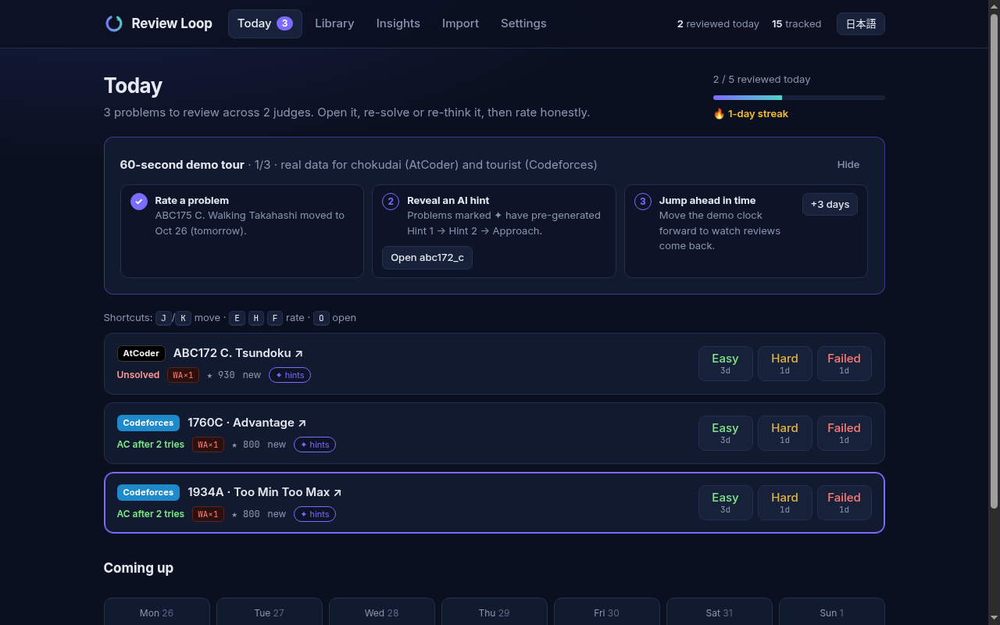
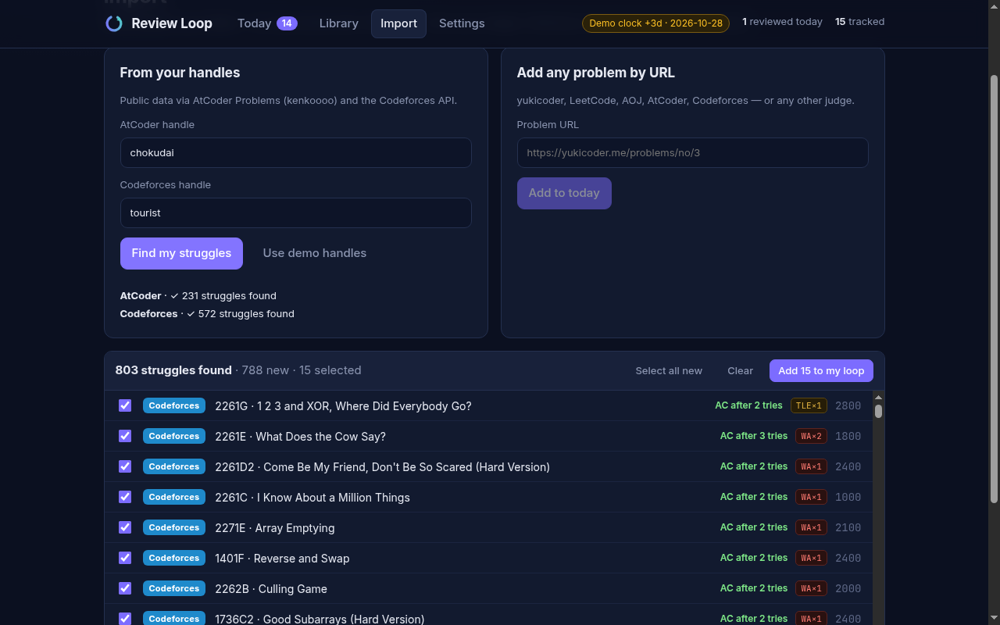
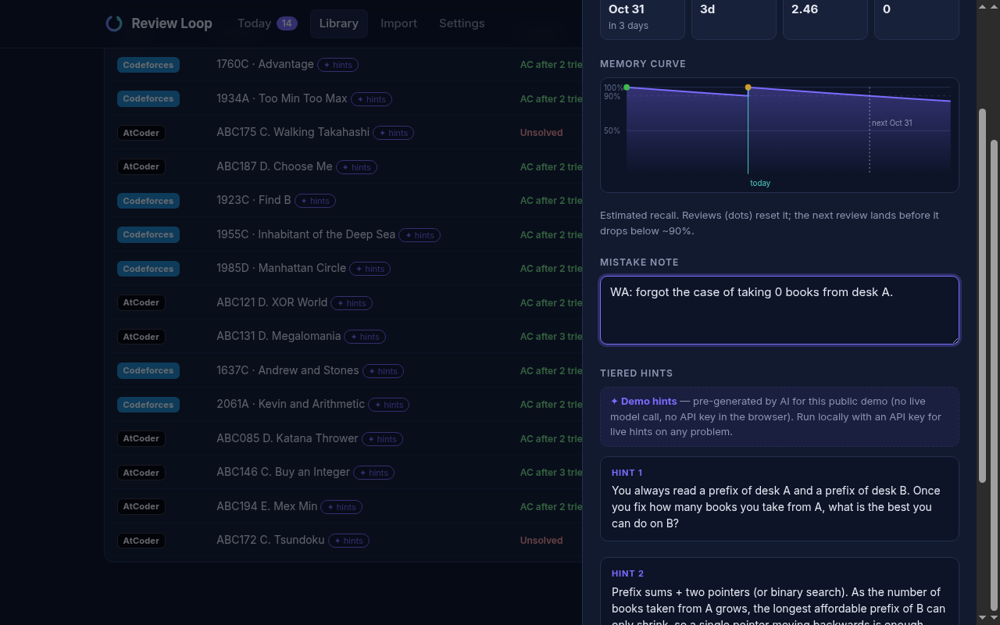
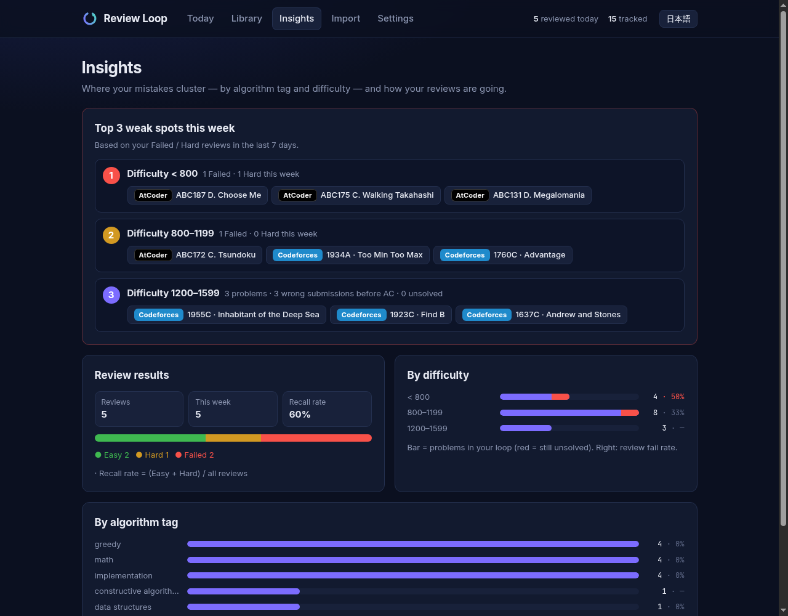
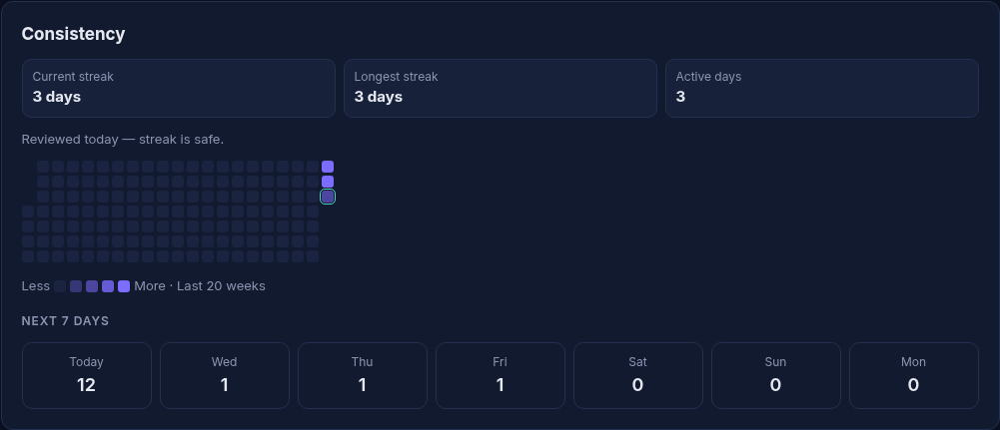

# Review Loop

**A spaced-repetition review coach for competitive programmers — across every judge.**

▶ **Demo video (YouTube): https://youtu.be/_KL9NTGdaHI**

Live demo: **https://taku629.github.io/review-loop/** (works fully in the browser; data stays in your localStorage). Press **“Try with demo handles”** and a 60-second guided tour walks you through rating, AI hints and the demo clock.

| Today — one queue across judges | Import preview — verdict chips | Problem drawer — memory curve & tiered hints |
| --- | --- | --- |
| [](docs/screenshots/today.png) | [](docs/screenshots/import-preview.png) | [](docs/screenshots/drawer.png) |

| Insights — top 3 weak spots, by difficulty and tag | Consistency — streak, heatmap, next 7 days |
| --- | --- |
| [](docs/screenshots/insights.png) | [](docs/screenshots/activity.png) |

Video file: [`demo/review-loop-demo.mp4`](demo/review-loop-demo.mp4) · also on the [v1.0 release](https://github.com/taku629/review-loop/releases/tag/v1.0) · Devpost write-up: [`devpost/submission.md`](devpost/submission.md)

Review Loop pulls the problems you **failed**, or solved only after **WA / TLE / MLE / RE**, from **AtCoder** and **Codeforces**, lets you add any other problem by URL (**yukicoder, LeetCode, AOJ**, or any judge), and schedules each one on a forgetting curve. Every day, the **Today** view shows what's due across all judges in one list, linked to the original problem. After re-solving, rate it **Easy / Hard / Failed** and the next review date moves (SM-2 style).

## Who it's for

Student competitive programmers who practise on several judges and keep forgetting the mistakes they already paid for. Existing tools track progress per judge; Review Loop keeps one memory queue for all of them.

## Features

- **Import struggles by handle** — AtCoder via the public [AtCoder Problems API](https://github.com/kenkoooo/AtCoderProblems) (kenkoooo), Codeforces via the public [`user.status`](https://codeforces.com/apiHelp/methods#user.status) API. A problem counts as a struggle if it was never solved but had a real failure, or was solved only after one or more WA/TLE/MLE/RE/OLE (compile errors ignored). Preview with verdict chips and difficulty, choose what to add.
- **Add anything by URL** — AtCoder, Codeforces (contest/problemset/gym), yukicoder, LeetCode, AOJ and arbitrary URLs are recognised and get a judge badge.
- **SM-2 style scheduler** — Easy 3 d → 7 d → ~19 d → …, Hard grows slowly, Failed brings it back tomorrow and lowers ease. Each button shows the interval it will give.
- **Today** — one list across judges, overdue first, with progress and a 7-day forecast. Imports are spread at *N new per day* (default 5) so a big backlog never floods you.
- **Library & problem drawer** — filter/search everything, write a **mistake note** (shown on Today), see review history and an estimated **memory curve**, reveal tags as a spoiler-level hint.
- **Insights (weak-spot analysis)** — failure counts and review results by **algorithm tag** (Codeforces) and **difficulty band** (both judges), a recall-rate summary, and **“Top 3 weak spots this week”** ranked from your Failed/Hard reviews in the last 7 days (falls back to import history before you review), each with the problems to practise first.
- **Consistency** — review **streak** (current / longest, also shown on Today), a **GitHub-style heatmap** of daily reviews for the last 20 weeks, and how many reviews are due on each of the **next 7 days**.
- **Keyboard-first reviewing** — on Today, <kbd>J</kbd>/<kbd>K</kbd> (or ↑/↓) move, <kbd>E</kbd> / <kbd>H</kbd> / <kbd>F</kbd> rate Easy / Hard / Failed, <kbd>O</kbd> opens the problem drawer (mistake note, memory curve, hints). Keys are ignored while typing.
- **Settings** — handles, pace, **demo clock** (jump +1/+3/+7 days to see reviews come due), JSON export/import, reset.
- **Tiered AI hints** — *Hint 1 → Hint 2 → Approach*, revealed one at a time. Live hints for any problem need `OPENAI_API_KEY` on the local server (the key never reaches the browser). The public site has no server, so it ships **✦ demo hints** pre-generated by AI for 40 of the demo handles' problems (filter them in the Library with “Has ✦ hints”, or pick them in the Import preview with “Select ✦ hint problems”) (`public/demo-hints.json`), clearly labelled as such. Without any of this, everything else still works.

Demo handles: `chokudai` (AtCoder) and `tourist` (Codeforces). The welcome screen's one-click demo loads a bundled snapshot of their real struggles (`public/demo/snapshot.json`) instantly; the Import tab fetches live data.

## Run it locally

Requires Node 20+.

```bash
npm install
npm run dev          # http://localhost:5173/review-loop/
```

Other commands:

```bash
npm test             # unit tests (scheduler, URL parser, struggle detection)
npm run build        # type-check + production build into dist/
npm run preview      # serve the build (also serves the optional hint API)
```

### Optional: AI hints

```bash
cp .env.example .env    # then set OPENAI_API_KEY (any OpenAI-compatible endpoint via OPENAI_BASE_URL)
npm run dev
```

The `/review-loop/api/hint` endpoint is a tiny Vite dev/preview-server middleware (`server/hintPlugin.ts`). The static GitHub Pages deployment has no server, so hints show as "off" there by design.

## How it works

- **Stack:** Vite + React 19 + TypeScript, no backend, no router/state library, hand-written CSS. State is a single reducer persisted to `localStorage` (`review-loop/v1`).
- **Key files:** `src/lib/srs.ts` (scheduler), `src/lib/importers/` (AtCoder/Codeforces fetch + `struggles.ts` detection), `src/lib/urlParse.ts`, `src/lib/store.ts`, `src/components/` (views).
- **AtCoder titles:** the build step (`scripts/fetch-atcoder-meta.mjs`) snapshots problem titles/difficulties into `public/atcoder-meta.json`, because the kenkoooo CDN sometimes serves cached copies without CORS headers. The app falls back to the live files, then to IDs.
- **Deploy:** GitHub Actions runs tests + build on every push (`ci.yml`) and publishes `dist/` to GitHub Pages (`pages.yml`).
- **Planning docs** from the Devpost *Build With AI: Basics* skill pack: [`devpost/scope.md`](devpost/scope.md), [`devpost/prd.md`](devpost/prd.md), [`devpost/spec.md`](devpost/spec.md), [`devpost/checklist.md`](devpost/checklist.md), [`devpost/app-map.html`](devpost/app-map.html).

## How I built it with AI

Review Loop was built with **[Devin](https://devin.ai)** (an AI software engineer) driven by the **[Devpost Learn Skill Pack](https://github.com/challengepost/learn-ai-basics)** (`npx skills add challengepost/learn-ai-basics --all -y`), starting from an empty folder.

**Flow: scope → PRD → spec → build → ship → polish**

1. **1-start** — learner profile ([`devpost/learner-profile.md`](devpost/learner-profile.md)). The skills interview the builder; Devin answered from my written product brief.
2. **2-scope → [`scope.md`](devpost/scope.md)** — one loop only: import struggles → schedule → review today. Accounts, sync, scraping and automatic re-solve detection were cut.
3. **3-prd → [`prd.md`](devpost/prd.md)** — the core journey, every screen, empty/error states and the proof-of-concept boundary.
4. **4-spec → [`spec.md`](devpost/spec.md)** — stack, data model, API contracts, the SM-2 formula, file layout, deploy target.
5. **5-build** — six vertical slices from [`checklist.md`](devpost/checklist.md), each tested and committed (scheduler + Today → imports → library/drawer → settings/demo clock → optional AI hints → CI/Pages).
6. **6-ship** — README, GitHub Pages, a scripted demo video and the [Devpost write-up](devpost/submission.md).
7. **Polish** — one PR per item, each passing `npm test` + `npm run build` in CI and checked on the live site after merge: [demo AI hints](https://github.com/taku629/review-loop/pull/1), [one-click demo tour](https://github.com/taku629/review-loop/pull/2), [README media](https://github.com/taku629/review-loop/pull/3), [error handling + cached fallback](https://github.com/taku629/review-loop/pull/4), [375px layout](https://github.com/taku629/review-loop/pull/5), [Japanese UI](https://github.com/taku629/review-loop/pull/6).

**What the AI did**
- Turned the brief into the scope/PRD/spec drafts and followed them.
- Wrote all of the code, unit tests (Vitest), CI and Pages workflows.
- Checked the real APIs (CORS, rate limits, odd responses such as AtCoder Problems returning `[]` for unknown users) and designed the fallbacks.
- Wrote the ✦ demo hints (Hint 1 → Hint 2 → Approach for 20 demo problems).
- Translated the UI into Japanese.
- Made the demo video by scripting the live site with Playwright, with edge-tts narration and captions.
- Verified each change in a real browser, including on the deployed site.

**What I decided**
- **The problem and the user.** Student competitive programmers who practise on several judges and forget mistakes they already paid for. The product had to be cross-judge, not one more single-judge tracker.
- **The product rules.**
  - A "struggle" means WA/TLE before AC, or never solved.
  - Easy / Hard / Failed ratings drive an SM-2 style schedule.
  - Problems from any judge can be added by URL.
  - Data stays in the browser; no accounts.
- **The AI boundary.** AI hints are optional and the app must work fully without a key. The key never reaches the browser. On the keyless public site, hints are pre-generated and clearly labelled as such.
- **Hard constraints.** Free hosting, real public demo users (`chokudai`, `tourist`), and planning docs committed to the repo.
- **How work lands.**
  - Priorities for the polish round.
  - One item per PR.
  - Tests and build must pass, and `main` must never break.
  - Every change is checked on the live site.
  - Which PRs got merged.

## What I learned

- **Writing scope → PRD → spec before code paid off.** Cutting accounts, scraping and auto-detecting re-solves in `scope.md` kept the build to one coherent loop that could be finished and polished.
- **"Struggle" needed a precise definition to be testable.** Counting only failures *before the first AC* and ignoring compile errors turned a fuzzy idea into a few unit tests (`tests/struggles.test.ts`).
- **Public APIs behave differently in a browser than with curl.** The AtCoder metadata files returned CORS headers to curl but were blocked in Chrome because a CDN cached a copy without them; a build-time snapshot plus fallbacks fixed it.
- **A demo clock makes a time-based product demonstrable.** Spaced repetition is invisible in a 2-minute video unless you can move time forward.
- **Optional AI should be a layer, not a dependency.** Keeping the key server-side and the no-key path first-class meant the core product never depends on an LLM.

## License

MIT
